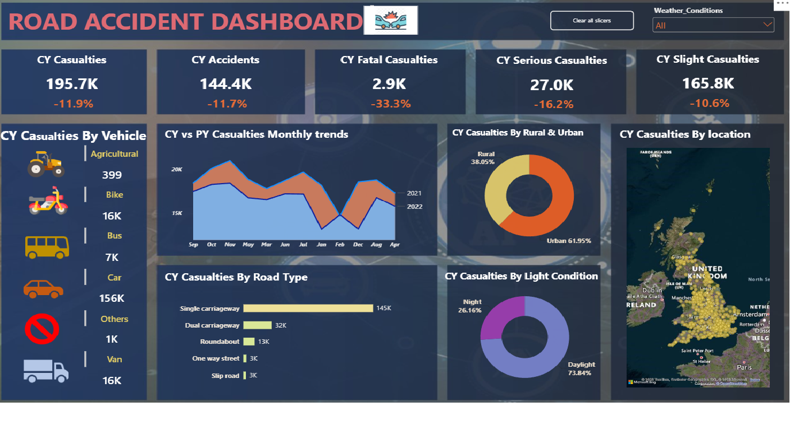

🚗 Road Accident Dashboard – Power BI
📌 Project Overview
This project analyzes road accident data using Microsoft Power BI to identify trends and patterns in road accidents.

🛠️ Tools & Technologies
Microsoft Power BI
Power Query
DAX
Microsoft Excel
📊 Key Insights
Total Accidents
Total Casualties
Fatal, Serious and Slight Casualties
Monthly Accident Trends
Casualties by Vehicle Type
Accidents by Road Type
Urban vs Rural Accidents
📈 Dashboard Features
Interactive dashboard with KPIs, charts, filters and visualizations to understand road accident trends.

📁 Project File
Power-BI-Road-Accident-Dashboard.pbix

## 📸 Dashboard Preview

